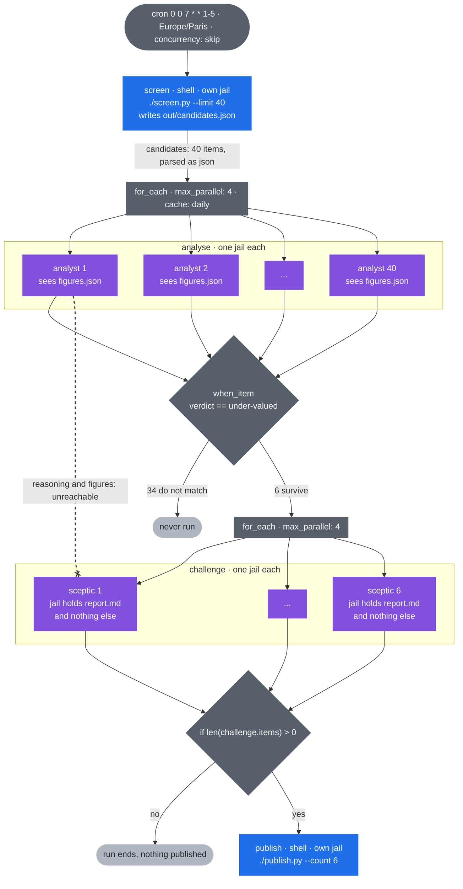

# cadence

A scheduler and workflow engine for AI agents.

Cron runs a command at a time. `cadence` runs a *graph* of agent steps at a
time: steps declare what they depend on, pass results forward, fan out over
lists, run in parallel under a bound, and each one executes inside its own
OS-enforced jail.

```
cadence run research-funnel.yaml
running research-funnel (sandbox: seatbelt)
  screen               succeeded
  analyse              succeeded (38 items)
  challenge            succeeded (6 items)
  publish              succeeded

run 12 succeeded
```

## Why

Useful agent work is almost never one prompt. The shape that keeps recurring
is this one:

1. a script gathers data, with no model involved,
2. N agents analyse that data in parallel,
3. an adversarial agent tries to break each surviving conclusion, **without
   having seen the first agent's reasoning**,
4. a decision rule fixed in advance is applied to whatever survives.

Step 3 is the hard part, and it is the reason this project exists. Two agents
on the same model looking at the same data agreeing is weak evidence. A
sceptic is only worth running if it genuinely cannot see the conclusion it is
meant to attack. Schedulers that fire one prompt and capture stdout never have
to answer that question. `cadence` answers it with the filesystem.

## Isolation

Every step item gets its own directory tree, created fresh:

```
<run>/<step>/<item>/
    work/      the process working directory
    work/out/  where the step writes results
    meta/      stdout, stderr and metadata, owned by the engine
```

Three things follow from that:

- **A step reads only what it declared.** Downstream steps do not read upstream
  directories. They declare `inputs:`, which the engine materialises inside
  `work/` before the process starts. The sceptic's jail contains `report.md`
  and nothing else, so there is no analyst reasoning to find.
- **The environment is built, not inherited.** A child gets `PATH`, `HOME` and
  a short allowlist, plus whatever the step's `env:` names. A credential
  sitting in your shell does not silently reach every step, and the agent
  CLI's own credentials reach agent steps only. `TMPDIR` points at a directory
  inside the jail, so a step's scratch files are its own.
- **The kernel enforces it.** On macOS through a generated `sandbox-exec`
  profile, on Linux through `bubblewrap` with a fresh mount namespace.

`meta/` is never inside `work/`, so a step cannot read the engine's record of
itself or of anything else.

### When it cannot be enforced

If neither mechanism is available, `cadence` falls back to a `confined`
backend that sets the working directory and the environment and nothing more.
That is a real loss, so it is never silent:

- `cadence doctor` names the active backend and says plainly what it does not do
- the terminal interface shows it on every run
- a workflow can set `require_sandbox: true` and will refuse to run rather than
  degrade

```
$ cadence doctor
sandbox backend: seatbelt
                 isolation is enforced by the kernel
claude CLI:      /usr/local/bin/claude
```

## Install

```bash
git clone https://github.com/hacKarim/cadence.git
cd cadence
go build -o cadence ./cmd/cadence
```

Requires Go 1.24+ and the [Claude CLI](https://github.com/anthropics/claude-code)
on your `PATH` for agent steps.

## A workflow

This is [`examples/research-funnel.yaml`](examples/research-funnel.yaml), the
shape described above: screen deterministically, analyse in parallel, then let
a sceptic attack each surviving case without showing it how that case was
built.



The crossed link is the point of the project. `analyst 1` produced the report
that `sceptic 1` is attacking, but the sceptic's jail was built from
`inputs: report.md` alone, so the analyst's reasoning, its `figures.json` and
every sibling jail are unreachable: not by convention, but because
`sandbox-exec` or `bubblewrap` denies the read.

The YAML behind it, lightly abridged:

```yaml
name: research-funnel
schedule: "0 0 7 * * 1-5"      # six fields: second minute hour day month weekday
timezone: Europe/Paris
concurrency: skip
require_sandbox: true

defaults:
  timeout: 20m
  retries: 1
  backoff: { base: 5s, factor: 2, max: 2m }

notify:
  on: [failure]
  slack: ${SLACK_WEBHOOK}

steps:
  - id: screen
    run: ./screen.py --out out/candidates.json
    outputs:
      candidates: { from: file, path: candidates.json, as: json }

  - id: analyse
    needs: [screen]
    for_each: '{{ .steps.screen.outputs.candidates }}'
    max_parallel: 4
    cache: daily
    inputs:
      figures.json: '{{ .item | json }}'
    agent:
      tools: [Read, Write, WebSearch]
      prompt: |
        Read figures.json and analyse {{ .item.ticker }}.
        End your report after a line containing =====REPORT=====
      extract: { after: "=====REPORT=====" }
    outputs:
      verdict: { from: stdout, as: raw, regex: '"verdict":"([a-z-]+)"' }

  - id: challenge
    needs: [analyse]
    for_each: '{{ .steps.analyse.items }}'
    when_item: '{{ eq .item.outputs.verdict "under-valued" }}'
    inputs:
      report.md: '{{ .item.result }}'
    agent:
      tools: [Read]
      prompt: |
        You are the sceptic. Read report.md. Your only job is to find out
        whether its case is wrong. Do not try to be balanced.
    outputs:
      verdict: { from: stdout, as: raw, regex: 'VERDICT=(\w+)' }

  - id: publish
    needs: [challenge]
    if: '{{ gt (len .steps.challenge.items) 0 }}'
    run: ./publish.py --count {{ len .steps.challenge.items }}
```

More in [`examples/`](examples/). They are covered by the test suite, so they
cannot drift away from what the engine actually implements.

## The spec language

A step has exactly one of `run:` (a shell command) or `agent:` (a `claude`
invocation).

| Key | Meaning |
|---|---|
| `needs` | steps that must finish first; also bounds what the step may reference |
| `for_each` | a list to fan out over; each element becomes `.item` |
| `when_item` | run this item only when the condition holds |
| `if` | run this step only when the condition holds |
| `max_parallel` | items in flight for this step |
| `inputs` | files staged into `work/` before the step starts |
| `outputs` | values lifted out of what the step produced |
| `env` | environment entries; `${VAR}` expands from your shell at load time, and the value is a template like any other |
| `allow` | paths outside the jail this step may read and write |
| `cache` | `never` (default), `daily`, or `always` |
| `isolate` | give the step a clean working directory |
| `timeout`, `retries`, `backoff` | applied per item, not per step |
| `on_item_failure` | `continue` (default) or `fail_fast` |

Templates are Go `text/template` with a small fixed helper set: `json`, `trim`,
`lines`, `indent`, `default`, `file`. Nothing in it can read the filesystem or
shell out.

**References are checked before anything runs.** The validator walks each
template and rejects a workflow where a step reads `.steps.<id>` that is not in
its `needs` closure. Without that check, `needs` would be decoration and the
isolation guarantee would rest on convention:

```
$ cadence validate funnel.yaml
step "challenge": agent.prompt: references step "screen", which is not in the
needs closure of "challenge"; add it to needs
```

Outputs are declared, never guessed:

```yaml
outputs:
  candidates: { from: file, path: candidates.json, as: json }
  verdict:    { from: result, as: json, select: "$.verdict" }
  build_id:   { from: stdout, as: raw, regex: 'id=(\d+)' }
```

To hand a downstream step a file rather than its contents, use the `file`
helper with `copy:`:

```yaml
inputs:
  data.json: { copy: '{{ file .steps.screen "candidates.json" }}' }
```

## Running

```
cadence                          the interactive interface
cadence run <workflow.yaml>      run now
cadence run <wf> --resume <id>   resume a failed run
cadence validate <workflow.yaml> parse and check without running
cadence runs [workflow]          recent runs
cadence logs <run-id> [step]     what a run produced
cadence daemon [--dir DIR]       background scheduler
cadence doctor                   sandbox backend and CLI status
cadence cache prune
```

### Caching and resume

A step item's cache key hashes the resolved step, the staged inputs and the
workflow file. `cache: daily` folds the date in, which matches the usual
pattern of reusing today's work and redoing it tomorrow. Environment values are
excluded, so rotating a credential does not invalidate everything.

`--resume` creates a *new* run that inherits the earlier one's successful
steps, leaving the failed run on record exactly as it happened. If the workflow
file changed since then it refuses, rather than quietly mixing results from two
different definitions.

Resume is step-granular. A fan-out step that was interrupted with 38 of 40
items finished is re-run in full, because only whole successful steps are
inherited. `cache: always` on that step makes the finished items free on the
second attempt, which is the way to get item-level resume today.

### Scheduling

`concurrency` decides what a trigger does while a previous run is still going:
`skip` (the default, and it records a skipped run so the gap is visible),
`queue`, or `allow`. The lock lives in the database, so a manual `cadence run`
and the daemon cannot start the same workflow twice.

Schedules missed while the daemon was down are dropped by default. A week of
downtime should not launch 120 agent runs. `catchup: true` fires once to cover
the gap, never once per missed slot.

## Permissions

Agent steps run without `--dangerously-skip-permissions`. A step that needs to
write says so:

```yaml
agent:
  tools: [Read, Write, Bash]
  elevated_permissions: true
```

An unattended scheduler that silently grants agents full write access is a
footgun, so the default stays restrictive even though it means some workflows
have to ask.

## Known limits

- **Agent credentials must be reachable from inside the jail.** On macOS the
  Claude CLI keeps its credentials in the keychain, which a `sandbox-exec` jail
  cannot reach. Either put an API key in the step's `env:`, or set
  `CADENCE_SANDBOX=confined` to accept the weaker backend. `doctor` and the
  interface both report when that override is in effect.
- **Agent steps are granted their CLI's own configuration and temp
  directories.** They have to be, or the process cannot start. This is a
  documented widening: an agent step with file tools can reach its own CLI
  state. It still cannot reach another step's jail.
- **Agent steps share one directory with each other: the CLI's own per-user
  temp path**, which it opens by name and which therefore has to be granted.
  Their jails, scratch directories and outputs are all separate; that one path
  is not. Shell steps are not granted it.
- **`{{ .steps.<id>.result }}` is empty for a fan-out step**, which has many
  results rather than one. Use `{{ .steps.<id>.items }}` and read `.item.result`
  inside a `for_each`.
- `cadence` is single-machine and single-user. No remote runners, no multi
  tenancy.

## Status and roadmap

Shipped, with tests:

- [x] DAG scheduling: `needs`, topological ready set, bounded parallelism
- [x] Fan-out with `for_each`, `max_parallel`, `when_item`, `on_item_failure`
- [x] Conditional steps with `if`
- [x] OS-enforced isolation: `sandbox-exec` on macOS, `bubblewrap` on Linux,
      a reported `confined` fallback, and `require_sandbox` to refuse the fallback
- [x] Declared `inputs` staged into the jail, and an environment that is built
      rather than inherited
- [x] Declared `outputs` from a file, stdout or the agent result, as json or
      raw, with regex capture and JSONPath selection
- [x] Static reference checking: a template that reads a step outside its
      `needs` closure fails validation before anything runs
- [x] Content-addressed step cache, `never` / `daily` / `always`
- [x] `--resume`, inheriting successful steps as a new run
- [x] Cron with timezone, `concurrency: skip`, `catchup`, and a daemon whose
      lock lives in the database, so a manual run cannot race it
- [x] Per-item `timeout`, `retries` and exponential `backoff`
- [x] Slack or Discord webhook notification on run events
- [x] Interactive interface, plus `validate`, `doctor`, `runs`, `logs`,
      `cache prune`
- [x] Shipped examples parsed and validated by the test suite, so they cannot
      drift from the engine

Next, roughly in the order I would build them:

- [ ] **Budgets.** `budget: { usd: 5, minutes: 30 }` for a whole run. The agent
      envelope already carries `total_cost_usd` per call, so the engine can
      stop launching fan-out items once a run has spent its allowance, and say
      what it skipped.
- [ ] **Item-level resume.** Today `--resume` is step-granular, so an
      interrupted 40-item fan-out pays for all 40 again unless it was cached.
      Inheriting finished items individually is the fix.
- [ ] **Pause for input.** A step that parks the run and waits on a person:
      `cadence inbox` to see what is blocked, `cadence inbox reply <run> <step>`
      to unblock it. Approval gates are the obvious use, and a scheduled
      workflow that needs a decision currently has to fail instead.
- [ ] **Run reports.** `cadence report <run-id> -o report.md`: the graph, each
      step's duration and cost, the outputs, and the failures, as one file fit
      to paste into a pull request or an issue.
- [ ] **Pinned verifiers.** Mark a step as the judge, and hash-pin its spec and
      its inputs at load time, so nothing upstream can rewrite the thing that
      scores it. The jail already stops a step reading the verifier; this stops
      it rewriting one.
- [ ] **Best-of-N.** `strategy: { best_of: 5, score: <step> }`: run N variants
      of a step in N jails and keep whichever a scorer ranks highest. The
      fan-out machinery already does the hard part.
- [ ] **Memory that outlives the run.** A small append-only store, kept in git,
      that a workflow reads at the start and writes at the end, each entry
      carrying the run that produced it. A daily workflow should be able to
      stop repeating yesterday's mistake.
- [ ] **A second agent backend.** `agent: { backend: codex }`. The runner
      interface is already an interface; what is missing is a second envelope
      parser and a second set of sandbox support paths.
- [ ] **A container backend.** A third sandbox beside seatbelt and bubblewrap,
      for disposable containers and for hosts where neither is available.
- [ ] **`cadence-mcp`.** An MCP server over run history, step outputs and logs,
      so the agent you are already talking to can ask what the scheduler did
      overnight.
- [ ] **`doctor --probe`.** One real agent call per configured backend, so
      `doctor` proves the credentials work instead of proving the binary exists.

Several of those are adapted from [kapso](https://github.com/Leeroo-AI/kapso),
which solves a different problem (searching a tree of ML experiments) but has
good answers for budgets, pausing on human input, and keeping what a run
learned.

## Development

```bash
go test ./...                          # unit tests, no network, no model calls
go test -tags integration ./...        # also exercises the real sandbox
```

The engine depends only on a `Runner` interface, so the whole execution model
is tested against a fake with scripted latency and failures. The isolation
guarantee has tests at both levels: one asserts a staged jail contains exactly
the declared files, and a tagged integration test asserts the kernel actually
refuses a write outside the jail and a read of a sibling step's output.

## License

MIT. See [LICENSE](LICENSE).
